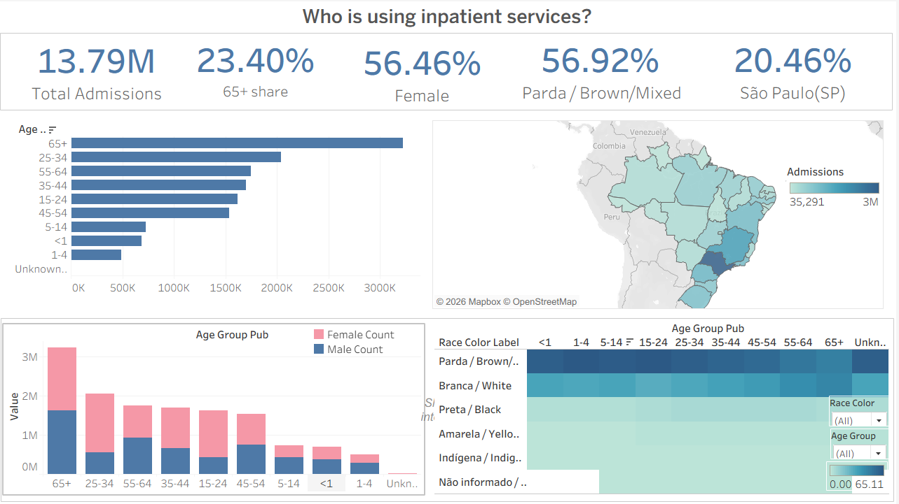
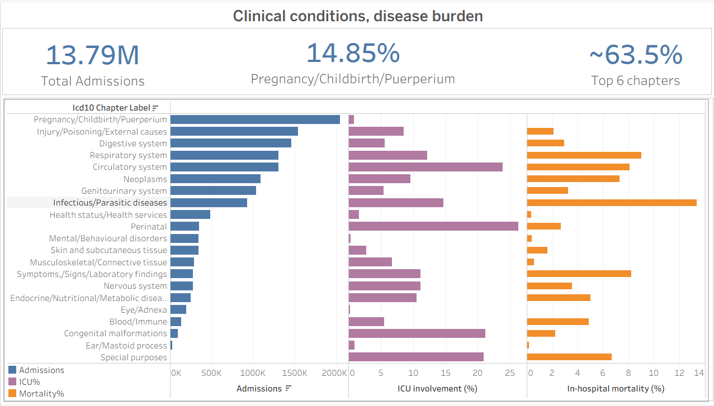
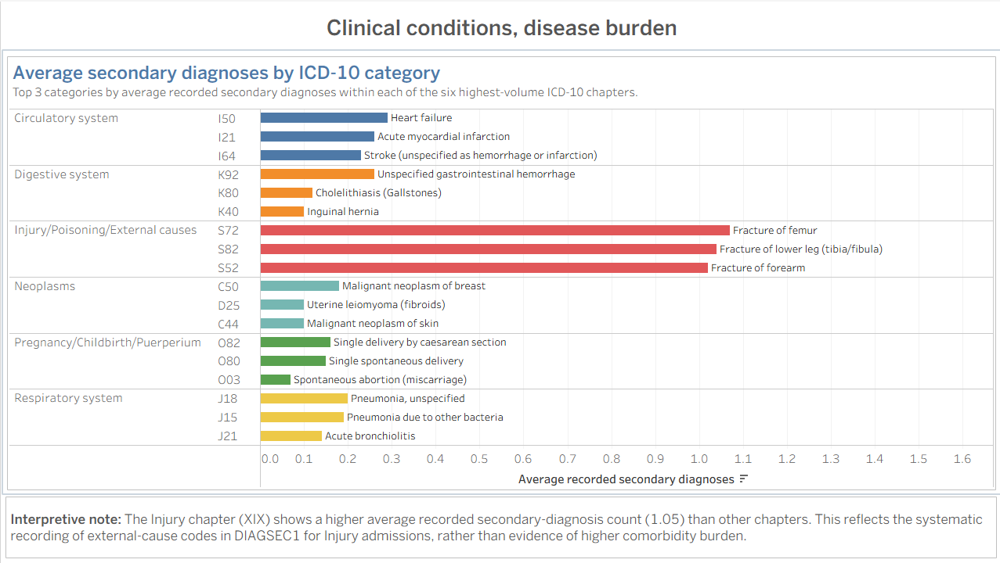
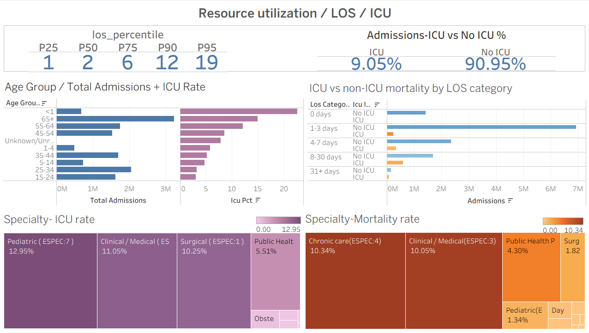
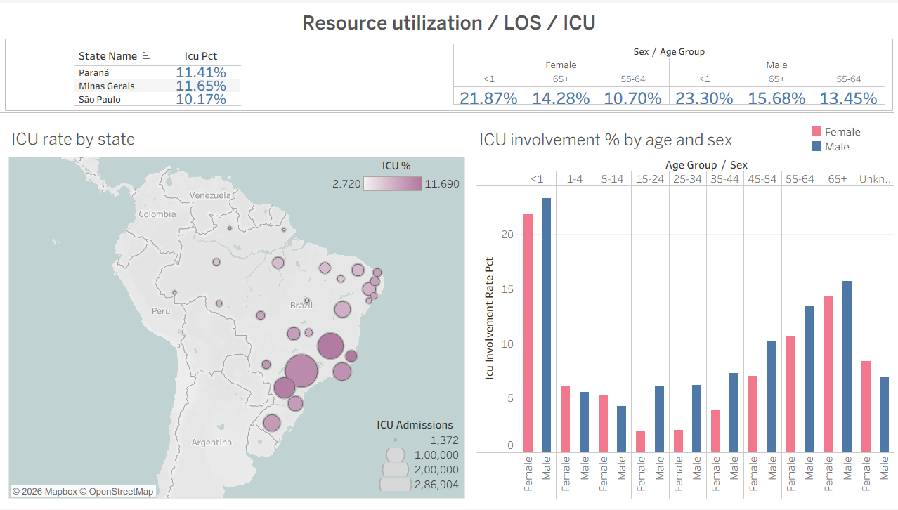
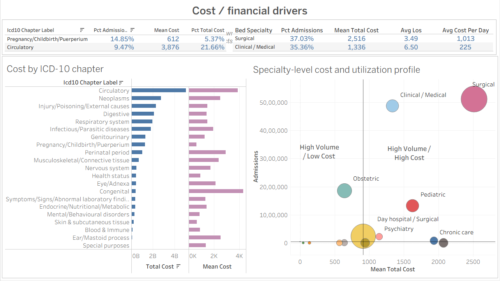
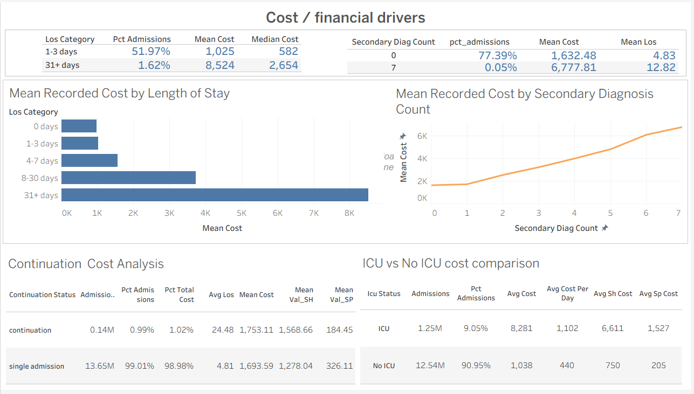

# SIH/SUS 2024 Hospital Admissions Analytics

An end-to-end healthcare analytics project examining Brazil's 2024 SIH/SUS hospital admission records, covering **13,786,854 records** across the full calendar year. The project combines data validation, variable selection, SQL-based analysis, and Tableau visualization to investigate demographic composition, diagnostic case mix, resource utilization, and recorded reimbursement patterns.

The analysis emphasizes data quality, transparent methodology, and descriptive(non-causal) interpretation of real-world healthcare data.


**[Dashboard previews]















**[View the interactive Tableau dashboard](https://public.tableau.com/views/SIH_SUS_2024_Hospital_Admissions_Analytics/demography?:language=en-US&:sid=&:redirect=auth&:display_count=n&:origin=viz_share_link)**

---

## Project overview

The Hospital Information System of Brazil's Unified Health System (SIH/SUS) provides administrative records relating to hospital admissions. This project examines patterns and variation in the 2024 records through four analytical questions:

1. **Demographics:** Who is represented in the recorded hospital admissions?
2. **Clinical case mix:** Which diagnostic groups account for the recorded admissions?
3. **Resource utilization:** How do length of stay, ICU involvement, mortality, and related utilization measures vary?
4. **Hospitalization expenditure:** How does recorded expenditure vary with length of stay, diagnosis, ICU involvement, specialty, and secondary-diagnosis count?

The project is deliberately **descriptive and variation-focused**, rather than causal or performance-focused. The findings describe observed patterns and associations; they do not establish causal effects or independently assess hospital quality or efficiency.

## Headline findings

| Analytical area                       | Key finding                                                                                                                                                                                                           |
| ------------------------------------- | --------------------------------------------------------------------------------------------------------------------------------------------------------------------------------------------------------------------- |
| **Scale**                             | 13,786,854 admission-level records covering January–December 2024                                                                                                                                                     |
| **Demographics**                      | Female records accounted for 56.46%; Parda (brown/mixed) records accounted for 56.92%; records for people aged 65 and older accounted for 23.40%                                                                      |
| **Diagnostic case mix**               | The six largest ICD-10 chapters accounted for approximately 63.5% of records. Pregnancy, childbirth and the puerperium formed the largest chapter group, at 14.85%                                                    |
| **Length of stay**                    | Median recorded length of stay was 2 days, compared with a mean of approximately 5 days, indicating a right-skewed distribution                                                                                       |
| **ICU involvement**                   | Approximately 9.05% of records involved ICU care                                                                                                                                                                      |
| **ICU and length of stay**            | The proportion of records involving ICU care increased across length-of-stay categories, from approximately 1.0% for records with 0 days to 33.4% for records with stays of 31 days or more                           |
| **Expenditure and diagnostic burden** | Average recorded expenditure increased across secondary-diagnosis-count groups, from approximately R$1,632 to R$6,778. Average length of stay also increased across those groups, from approximately 4.8 to 12.8 days |

*Interpretation note:* These are descriptive findings. Differences between groups should not be interpreted as causal effects. The expenditure figures should be checked against the final query exports before publication to confirm currency, units, and rounding.

### An observed ICD-10 coding pattern

The analysis found no records assigned to ICD-10 Chapter XX (External causes) as the principal diagnosis. Separate queries also showed external-cause codes appearing in secondary diagnosis fields for records in the Injury chapter. This pattern was investigated in the context of SIH/SUS coding conventions rather than interpreted as evidence that external causes were absent from the underlying circumstances of hospital admissions.

---

## Data quality and methodology

Data validation was treated as a core part of the project, not simply as a preliminary cleaning step.

- **Full validation:** January–March 2024 was examined domain by domain across all 113 source variables and 11 domains to establish a baseline for schema, completeness, value patterns, and consistency.
- **Streamlined validation:** After stability was established, the remaining nine months were checked using a streamlined process focused on structural integrity, known issues, and changes in data patterns.
- **Data-type and formatting checks:** Issues involving leading-zero preservation and mixed data types were investigated to reduce the risk of silently altering administrative codes during extraction and import.
- **Join validation:** A potential row-multiplication problem in continuation/long-stay enrichment was investigated and addressed using a composite key rather than relying on `N_AIH` alone.
- **Reference verification:** External definitions and lookup mappings were checked against relevant SIH/SUS documentation and supporting references. Where a mapping was incomplete or uncertain, its analytical use was restricted accordingly.

The source dataset contains 113 variables. A structured selection process based on analytical relevance, interpretability, validation results, redundancy, and reference availability resulted in a **54-variable analysis-ready dataset**.

The project uses derived variables for analytical age groups, ICD-10 chapter labels, secondary-diagnosis count, length-of-stay categories, ICU involvement, continuation context, and cost per day where the denominator is valid.

## Repository Structure

```text
SIH-SUS-2024-Hospital-Admissions-Analytics/
├── data_enrichment/
│   ├── LEITOS_enriched.csv
│   ├── data_dictionary.md
│   ├── icd10_chapter_lookup_en.csv
│   ├── Q1_variable_reference.csv
│   ├── Q2_variable_reference.csv
│   ├── Q3_variable_reference.csv
│   └── Q4_variable_reference.csv
├── docs/
│   ├── PROJECT_STATUS_SUMMARY.md
│   ├── SIH_SUS 2024_Analytical_Plan_and_Scope.pdf
│   ├── SIH_SUS_2024_Variable_Selection_and_Analysis_Plan.xlsx
│   └── references.md
├── notebooks/
│   ├── ICD10_lookup/
│   │   └── ICD_10_lookup.ipynb
│   ├── extraction/
│   │   └── selected_variables_extraction.ipynb
│   └── validation/
│       ├── 01_validation_template.ipynb
│       ├── diff_log.md
│       └── streamlined_validation_template.ipynb
├── sql/
│   ├── 01_create_analysis_ready_table.sql
│   ├── 02_create_lookup_tables.sql
│   ├── 03_q1_demographics.sql
│   ├── 04_q2_clinical_case_mix.sql
│   ├── 05_q3_resource_utilization.sql
│   └── 06_q4_cost_analysis.sql
├── tableau/
│   └── screenshots/
│       ├── demography.png
│       ├── diagnosis_01.png
│       ├── diagnosis_02.png
│       ├── Resource_utilization_01.png
│       ├── Resource_utilization_02.png
│       ├── Cost_financial_drivers_01.png
│       └── Cost_financial_drivers_02.png
├── .gitignore
├── LICENSE
└── README.md
```
	
	
### Unit of analysis

The primary unit of analysis is the **SIH/SUS AIH admission-level record**. The results describe recorded admissions rather than unique patients or reconstructed hospitalization episodes. `N_AIH` is an admission-authorization identifier and is not treated as a guaranteed unique-patient identifier. Extended or administratively re-presented hospitalizations may involve multiple AIH records; full episode reconstruction is outside this project's scope.

---

## Analytical scope

### Q1 — Demographic composition

Examines age, sex, race/color, and selected geographic patterns in recorded admissions. Geography is interpreted cautiously according to the meaning and limitations of the available administrative fields.

### Q2 — Clinical case mix

Examines principal-diagnosis categories and ICD-10 chapters, secondary-diagnosis burden, mortality patterns, and selected relationships between diagnosis and resource utilization. Diagnostic groupings are used to support interpretable comparisons rather than presenting every individual diagnosis code.

### Q3 — Resource utilization

Examines length of stay, ICU and intermediate-care involvement, mortality in relation to utilization, continuation/long-stay context, and selected specialty and demographic relationships.

`DIAS_PERM` is the primary length-of-stay measure. `QT_DIARIAS` is treated as exploratory because the two measures are related but not identical.

### Q4 — Hospitalization expenditure

Examines recorded total expenditure (`VAL_TOT`), selected financial components, and expenditure variation by length of stay, ICU/intermediate-care involvement, specialty, principal diagnosis, secondary-diagnosis count, continuation context, and selected financing variables.

The analysis distinguishes total expenditure from individual financial components and avoids treating recorded reimbursement values as a complete measure of economic cost.

---

## Repository documentation

The repository contains supporting documentation for the project's scope, methodology, variable decisions, and source references.

- **[Final Analytical Plan & Scope](docs/SIH_SUS_2024_Analytical_Plan_and_Scope.pdf)** — analytical questions, executed analyses, variable decisions, exclusions, and limitations.
- **[Project Status Summary](docs/PROJECT_STATUS_SUMMARY.md)** — project decisions, methodology, validation history, and implementation notes.
- **[References](docs/references.md)** — external data documentation, technical references, lookup sources, and supporting literature.
- **[Variable Selection and Analysis Plan](docs/SIH_SUS_2024_Variable_Selection_and_Analysis_Plan.xlsx)** — detailed variable-level reference and rationale for inclusion, exclusion, or supporting use.

See the repository's actual directory structure for the available notebooks, SQL scripts, lookup tables, Tableau workbook, screenshots, and dashboard export files.

---

## Data source

The project uses the 2024 SIH/SUS hospital admissions data.

- **Data-access reference:** [SIH/SUS Hospital Admissions — 2024 dataset on Kaggle](https://www.kaggle.com/datasets/andersonfranca/sistema-de-informaes-hospitalares-sus)
- **Institutional documentation:** Brazil's Ministry of Health / DATASUS and the PCDaS / ICICT-Fiocruz SIH/SUS documentation and enrichment resources.

Kaggle served as a data-access reference. Institutional documentation and relevant technical references were used to interpret variables and coding conventions.

**Raw monthly source files, the full combined admission-level dataset, and the local SQLite database are not included in this repository.** Refer to the source links and project documentation to understand the data used and the decisions made during preparation.

---

## Tools and workflow

| Tool                            | Role in the project                                                                                  |
| ------------------------------- | ---------------------------------------------------------------------------------------------------- |
| **Python and Jupyter Notebook** | Source-data validation, variable selection, extraction, and preparation of reference and lookup data |
| **SQLite and DBeaver**          | Construction of the analysis-ready table and execution of SQL analyses for Q1–Q4                     |
| **Tableau**                     | Development of interactive dashboards and presentation of the analytical findings                    |
| **Git and GitHub**              | Version control and documentation of the portfolio project                                           |

The workflow progressed from source-data understanding and validation to variable selection, extraction, database construction, analytical SQL, and visualization.

---

## Scope and limitations

The results should be interpreted within the following boundaries:

- **Descriptive analysis:** Observed relationships do not establish causality.
- **Admission records, not unique patients:** The project does not estimate unique-patient counts or reconstruct complete hospitalization episodes.
- **No population-level admission rates:** Population denominators were not incorporated into this analysis.
- **Administrative data:** SIH/SUS fields reflect administrative and billing conventions as well as the coding structure of the system.
- **Expenditure interpretation:** `VAL_TOT` represents recorded SIH/SUS expenditure or reimbursement values, not necessarily the full economic cost of care. The analysis does not estimate cost-effectiveness, profitability, or value for money.
- **No hospital performance rankings:** The project does not make unsupported claims about hospital quality or efficiency. Clinical severity adjustment, staffing, and bed-capacity information required for such assessments are not incorporated.
- **Length-of-stay measures:** `DIAS_PERM` and `QT_DIARIAS` are related but not identical and are not treated as interchangeable.
- **Incomplete reference coverage:** Some auxiliary lookup information is incomplete; affected variables are restricted to contextual or exploratory interpretation.
- **Cost distributions:** Extreme expenditure values can influence averages, so group means are interpreted alongside distributional context where available.

The purpose is to demonstrate a reproducible, carefully scoped approach to healthcare data analysis: validating real-world data, documenting analytical decisions, producing descriptive findings, and communicating their limitations clearly.

---

## Project takeaway

This project demonstrates an end-to-end healthcare analytics workflow using real-world administrative data, with particular emphasis on data quality assessment, variable interpretation, SQL-based analysis, and transparent reporting.

The central outcome is not just a set of dashboards, but a documented analytical process showing how the data was assessed, how the questions were scoped, why variables were retained or excluded, and what conclusions the data can—and cannot—support.
